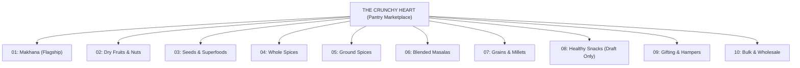

# THE CRUNCHY HEART — Complete Product Catalogue Expansion
## Document 02: Final Product Taxonomy & Classification Architecture (Phase 0)

**Date**: November 18, 2026  
**Scope**: 10 Core Pantry Categories, Subcategory Mappings, Attribute Matrix & Future Quarantine Rules

---

### 1. Master Category Architecture (10 Active & Managed Categories)

---

### 2. Detailed Taxonomy Breakdown

#### CATEGORY 01: MAKHANA (Flagship Category)
* **Raw Makhana**: Premium Mithila Makhana, Regular Makhana, Small, Medium, Large, Jumbo, Grade A (7S), Grade B (5S/6S).
  - *Pack Sizes*: 100g, 200g, 250g, 500g, 1kg.
* **Roasted Makhana**: Plain Roasted, Salted Roasted, Black Pepper Roasted, Masala Roasted.
* **Flavoured Makhana**: Peri Peri, Himalayan Pink Salt, Pudina, Cream & Onion, Cheese & Herbs, Tandoori, Tangy Tomato, Black Pepper, Indian Masala, Mint & Lime, Achari, Classic Salted.
  - *Pack Sizes*: 80g snack pouches, 4-pack bundles.

#### CATEGORY 02: DRY FRUITS & NUTS
* **Almonds**: Premium Almond, Regular Almond, Gurbandi Almond, Mamra Almond.
* **Cashews**: Small Cashew, Medium Cashew, Large Cashew, Jumbo Cashew.
* **Walnuts**: Whole In-Shell Walnut, Walnut Kernels (Chilean, Kashmiri).
* **Raisins (Kishmish)**: Kishmish Long, Kishmish Kandhari, Kishmish Indian, Black Kishmish, Golden Raisins.
* **Pistachios**: Regular Pista, Roasted & Salted Pista, Pistachio Kernels, Unsalted Pista.
* **Dates & Dried Fruits**: Medjool Dates, Kimia Dates, Ajwa Dates, Mabroom Dates, Regular Khajoor, Black Dates, Chuara (Variant 1 & 2), Munakka, Anjeer (Dried Figs), Dried Apricots (Khubani), Prunes, Dried Cranberries, Blueberries, Mulberries, Dried Mango, Pineapple, Kiwi, Cherries, Coconut Chips.
* **Premium Imported Nuts**: Pecans, Hazelnuts, Brazil Nuts, Macadamia Nuts, Pine Nuts (Chilgoza).
  - *Pack Sizes*: 100g, 200g, 250g, 500g, 1kg.

#### CATEGORY 03: SEEDS & SUPERFOODS
* **Individual Seeds**: Pumpkin Seeds, Sunflower Seeds, Flax Seeds (Alsi), Chia Seeds, Watermelon Seeds (Tarbooz Magaz), Muskmelon Seeds (Kharbooja Magaz), White Sesame, Black Sesame, Basil Seeds (Sabja), Hemp Seeds, Poppy Seeds (Khus Khus).
* **Seed Combinations**: Mixed Seeds, Five-Seed Mix, Daily Nutrition Seed Mix, Roasted Seed Mix, Salad Topping Mix.
* **Superfood Grains**: White Quinoa, Red Quinoa, Black Quinoa, Amaranth (Rajgira).

#### CATEGORY 04: WHOLE SPICES
* **Whole Red Chillies**: Kashmiri Red Chilli, Byadgi Chilli (Dabbi & Kaddi), Guntur Sannam S4, Guntur 334/341, Teja S17, Mathania Chilli, Mundu / Gundu Chilli, Jwala Chilli, Bird's Eye Chilli.
* **Cumin & Coriander**: Regular Cumin, Bold Cumin, Sortex Cleaned Cumin, Black Cumin (Kala Jeera), Shahi Jeera, Coriander Seeds, Eagle Coriander, Scooter Coriander.
* **Cardamom**: Green Cardamom (5–6mm, 6–7mm, 7–8mm, 8mm+), Black Cardamom, White Cardamom, Green Cardamom Seeds.
* **Pepper**: Regular Black Pepper, Malabar Black Pepper, Tellicherry Black Pepper, White Pepper, Green Peppercorns.
* **Other Whole Spices**: Fennel Seeds, Yellow/Brown/Black Mustard Seeds, Fenugreek Seeds (Methi), Ajwain, Kalonji, Dill Seeds, Aniseed, Cloves, Ceylon Cinnamon, Cassia Cinnamon, Star Anise, Nutmeg, Mace, Bay Leaves (Tejpatta), Whole Turmeric, Dry Ginger (Sonth), Saffron (Kesar), Asafoetida (Hing), Stone Flower (Dagad Phool).

#### CATEGORY 05: GROUND SPICES
* **Red Chilli Powders**: Kashmiri Red Chilli Powder, Byadgi Chilli Powder, Guntur Chilli Powder, Teja Chilli Powder, Mathania Chilli Powder, Deggi Mirch, Hot, Mild, and Extra Hot variants.
* **Turmeric Powders**: Regular Haldi Powder, Lakadong Turmeric (High Curcumin), Salem Turmeric, Alleppey Turmeric, Sangli Turmeric.
* **Other Ground Spices**: Coriander Powder, Cumin Powder, Roasted Jeera Powder, Black Pepper Powder, Dry Ginger Powder, Amchur Powder, Ajwain Powder, Garlic Powder, Onion Powder, Cardamom Powder, Cinnamon Powder.
* **Chilli Flakes**: Crushed Red Chilli, Chilli Flakes with Seeds, Chilli Flakes without Seeds.

#### CATEGORY 06: BLENDED MASALAS
* Garam Masala, Kitchen King, Chaat Masala, Pav Bhaji Masala, Chole Masala, Rajma Masala, Biryani Masala, Tandoori Masala, Sabzi Masala, Sambhar Masala, Meat Masala, Tea (Chai) Masala, Panch Phoron.

#### CATEGORY 07: GRAINS & MILLETS
* **Traditional Indian Millets**: Bajra (Pearl Millet), Ragi (Finger Millet), Jowar (Sorghum), Foxtail Millet, Little Millet, Kodo Millet, Barnyard Millet, Proso Millet.
* **Premium Grains**: White/Red/Black Quinoa, Brown Rice, Red Rice, Black Rice, Hand-Pounded Rice, Barley, Amaranth, Buckwheat, Rolled Oats, Dalia, Poha.

#### CATEGORY 08: HEALTHY SNACKS & MIXES *(Status: Quarantined Draft)*
* Trail Mixes, Royal Nut Mix, Roasted Almonds/Cashews/Chickpeas, Masala Peanuts, Jaggery-Coated Nuts, Energy Snack Bites.
* *Rule*: Strictly draft. Will not appear as active or purchasable until recipes, shelf-life, and packaging are verified.

#### CATEGORY 09: GIFTING & HAMPERS
* Premium Dry Fruit Gift Box, Royal Nut Collection, Makhana Gift Box, Healthy Snacking Hamper, Corporate Gift Boxes, Festive Hampers.

#### CATEGORY 10: BULK & WHOLESALE
* B2B enquiry workflows for 5kg/10kg bulk bags of Makhana (Suta grades), wholesale Dry Fruits, Spices, Grains, and Private Label Packaging.

---

### 3. Future Categories (Quarantine List — DO NOT LAUNCH)

The following categories are catalogued for future roadmap planning, but **must NOT be exposed in the public navigation or database active categories**:
1. **Pulses & Legumes**: Moong Dal, Chana, Rajma, Toor Dal, Urad Dal, Masoor Dal.
2. **Flours & Sattu**: Chana Sattu, Ragi Flour, Jowar Flour, Bajra Flour, Multigrain Flour.
3. **Pantry Oils & Sweeteners**: Jaggery, Mishri, Raw Honey, Cold-Pressed Mustard/Sesame/Coconut Oil, Herbal & Green Teas.

---

### 4. SKU & Variant Structure Specification

Every sellable unit must follow a deterministic, human-readable SKU scheme:
- `TCH-[CATEGORY]-[ITEM]-[FORM/GRADE]-[WEIGHT]`
- *Examples*:
  - `TCH-ALM-MAMRA-250G` (Almond Mamra 250g)
  - `TCH-CSH-JUMBO-500G` (Cashew Jumbo 500g)
  - `TCH-CHL-KASH-WHL-100G` (Kashmiri Chilli Whole 100g)
  - `TCH-CHL-KASH-PWD-250G` (Kashmiri Chilli Powder 250g)
  - `TCH-TUR-LAK-PWD-100G` (Lakadong Turmeric Powder 100g)
  - `TCH-RAW-6S-500G` (Raw Makhana 6 Suta 500g)
