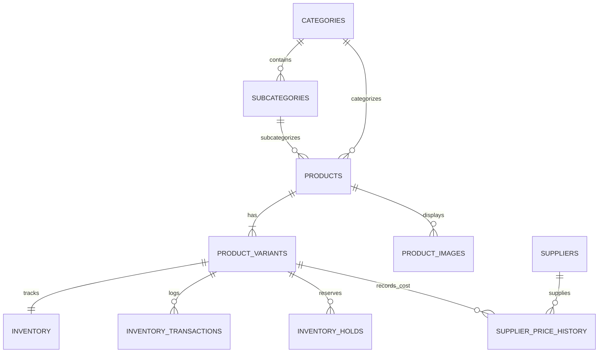

# THE CRUNCHY HEART — Complete Product Catalogue Expansion
## Document 03: Database Architecture & Domain Model Design (Phase 0)

**Date**: November 18, 2026  
**Scope**: Relational Schema Design, Additive Extensions, SKU Modeling, and Supplier Cost Isolation

---

### 1. Conceptual Domain Architecture

The data model treats **Products as Families** and **Variants as Sellable SKUs**. Pack sizes, varieties, forms, and grades are represented as structured variant rows rather than disconnected product records.



---

### 2. Physical Schema & Additive Extensions

To support the expanded catalogue without altering existing working queries, all schema changes are strictly **additive** using `ALTER TABLE ... ADD COLUMN IF NOT EXISTS`.

#### A. Core Products Table (`products`)
```sql
ALTER TABLE products 
  ADD COLUMN IF NOT EXISTS subcategory_id uuid REFERENCES subcategories(id) ON DELETE SET NULL,
  ADD COLUMN IF NOT EXISTS variety varchar(100),
  ADD COLUMN IF NOT EXISTS grade varchar(100),
  ADD COLUMN IF NOT EXISTS origin varchar(150),
  ADD COLUMN IF NOT EXISTS product_form varchar(50) DEFAULT 'standard',
  ADD COLUMN IF NOT EXISTS heat_level varchar(50),
  ADD COLUMN IF NOT EXISTS ingredients text,
  ADD COLUMN IF NOT EXISTS allergen_info text,
  ADD COLUMN IF NOT EXISTS storage_instructions text,
  ADD COLUMN IF NOT EXISTS fssai_license_number varchar(32) DEFAULT '10424000000001',
  ADD COLUMN IF NOT EXISTS shelf_life_days integer DEFAULT 180,
  ADD COLUMN IF NOT EXISTS publication_status varchar(30) NOT NULL DEFAULT 'active';

CREATE INDEX IF NOT EXISTS idx_products_publication_status ON products(publication_status);
CREATE INDEX IF NOT EXISTS idx_products_subcategory ON products(subcategory_id);
```

#### B. Product Variants Table (`product_variants`)
```sql
ALTER TABLE product_variants
  ADD COLUMN IF NOT EXISTS hsn_code varchar(16) DEFAULT '19041090',
  ADD COLUMN IF NOT EXISTS barcode_gtin varchar(32),
  ADD COLUMN IF NOT EXISTS batch_number varchar(64),
  ADD COLUMN IF NOT EXISTS pack_type varchar(50) DEFAULT 'pouch';

CREATE UNIQUE INDEX IF NOT EXISTS ux_product_variants_sku ON product_variants(UPPER(sku));
CREATE INDEX IF NOT EXISTS idx_product_variants_weight ON product_variants(weight_grams);
```

#### C. Supplier & Commercial Cost Tracking Tables (`suppliers`, `supplier_price_history`)
*Cost and procurement data is stored in isolated tables inaccessible to public customer-facing APIs.*
```sql
CREATE TABLE IF NOT EXISTS suppliers (
  id uuid PRIMARY KEY DEFAULT gen_random_uuid(),
  name varchar(200) NOT NULL,
  contact_person varchar(150),
  phone varchar(32),
  email varchar(150),
  city varchar(100),
  state varchar(100),
  gstin varchar(32),
  is_active boolean NOT NULL DEFAULT true,
  created_at timestamptz NOT NULL DEFAULT now(),
  updated_at timestamptz NOT NULL DEFAULT now()
);

CREATE TABLE IF NOT EXISTS supplier_price_history (
  id uuid PRIMARY KEY DEFAULT gen_random_uuid(),
  variant_id uuid NOT NULL REFERENCES product_variants(id) ON DELETE CASCADE,
  supplier_id uuid REFERENCES suppliers(id) ON DELETE SET NULL,
  rate numeric(12, 2) NOT NULL,
  unit varchar(32) NOT NULL DEFAULT 'kg',
  is_pending_confirmation boolean NOT NULL DEFAULT true,
  notes text,
  effective_date date NOT NULL DEFAULT CURRENT_DATE,
  created_at timestamptz NOT NULL DEFAULT now()
);

CREATE INDEX IF NOT EXISTS idx_supplier_history_variant ON supplier_price_history(variant_id);
```

---

### 3. SKU Generation Algorithm & Normalization

SKUs are deterministic and enforced unique across the entire database:
`TCH-[CAT]-[ITEM]-[VARIANT/FORM]-[WEIGHT]`

#### Rules:
1. `CAT`: 3-letter uppercase prefix (`MAk`, `ALM`, `CSH`, `WAL`, `KSH`, `PST`, `DAT`, `SED`, `WHL`, `GND`, `MSL`, `GRN`, `GFT`, `BLK`).
2. `ITEM`: Abbreviated item name (`MAMRA`, `JUMBO`, `KASH`, `LAK`, `BYD`).
3. `WEIGHT`: Numeric weight with unit (`100G`, `250G`, `500G`, `1KG`, `5KG`, `10KG`).
4. **Collision Prevention**: Database triggers and application layer validation reject any duplicate SKU insertion.

---

### 4. Security & Role-Based Access

| Endpoint / Table Column | Customer Storefront | Admin Operator |
|---|---|---|
| `products.publication_status` | Filtered (`WHERE publication_status = 'active'`) | Full view (Draft, Pending, Active, Archived) |
| `product_variants.selling_price` | Read-only | Full read/write |
| `product_variants.cost_price` | **Hidden / Never Selected** | Full read/write |
| `supplier_price_history` | **Blocked (403)** | Full management |
| `inventory.quantity_reserved` | Hidden (only available stock shown) | Full visibility |
