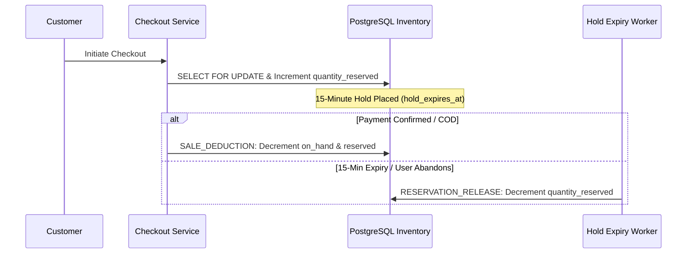

# THE CRUNCHY HEART — Complete Product Catalogue Expansion
## Document 07: Commercial Pricing & Inventory Management Rules

**Date**: November 18, 2026  
**Scope**: Pricing Architecture, Pro-Rated Pack Math, GST Place of Supply, and Atomic Inventory Holds

---

### 1. Commercial Pricing Architecture

The pricing model cleanly isolates procurement costs from customer retail prices:

```
[Supplier Rate / Cost Price] (Internal benchmark, never exposed)
          + Landed Logistics & Sorting
          + Nitrogen Pouch Packaging Cost
          + Operational & Payment Gateway Fees
          + Gross Margin Target
          = [Selling Price (Tax-Inclusive)]
          + Markup Factor (15-25%)
          = [MRP (Maximum Retail Price)]
```

#### Mathematical Formulas for Pack Sizes:
For weight-based pantry items (Dry Fruits, Spices, Seeds, Millets), selling prices are derived from a master per-kg rate:
$$\text{Selling Price} = \text{round}\left( \text{Per-Kg Rate} \times \frac{\text{Weight (grams)}}{1000} \right)$$
$$\text{MRP} = \max\left( \text{Selling Price}, \text{round}\left( \text{MRP Per-Kg} \times \frac{\text{Weight (grams)}}{1000} \right) \right)$$

#### GST Place-of-Supply Engine (`server/src/utils/gst.js`):
- **Roasted / Processed Pantry**: 5.0% GST (HSN `19041090`, `0802`, `0910`).
- **Raw Unbranded Makhana**: 0.0% GST.
- **Intra-State Supply (Bihar)**: 2.5% CGST + 2.5% SGST.
- **Inter-State Supply**: 5.0% IGST.

---

### 2. Atomic Inventory & Checkout Hold Lifecycle



#### Inventory Constraints & Safety Invariants:
1. `chk_quantity_on_hand_nonneg`: `quantity_on_hand >= 0`
2. `chk_quantity_reserved_nonneg`: `quantity_reserved >= 0`
3. `chk_reserved_le_on_hand`: `quantity_reserved <= quantity_on_hand`
4. **Formula for Purchasable Stock**:
   $$\text{Available Stock} = \text{quantity\_on\_hand} - \text{quantity\_reserved}$$
5. **No Negative Stock**: Orders attempting to reserve or deduct more than available stock fail immediately with HTTP 409 (`INSUFFICIENT_STOCK`).
