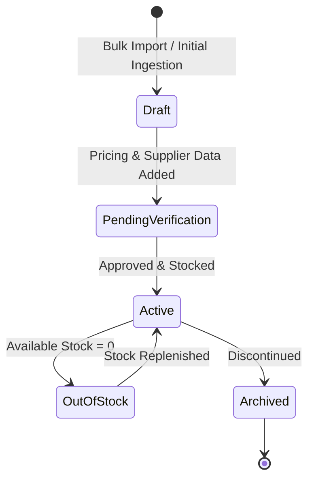

# THE CRUNCHY HEART — Complete Product Catalogue Expansion
## Document 08: Admin Panel Catalogue & Inventory Implementation Guide

**Date**: November 18, 2026  
**Scope**: Admin Product Management, Pack Size & Pricing Controls, Inventory Console, and Publication Workflow

---

### 1. Admin Architecture Overview

The owner console sits behind `adminAuthGuard` (HMAC SHA-256 session token authentication) with dedicated administrative endpoints under `/api/admin/*`.

| Route | Component | Key Operations |
|---|---|---|
| `/admin/products` | `AdminProductsComponent` | Filter by category, real-time search, pack variant counts, inventory on-hand summary, and publication status. |
| `/admin/products/:productId` | `AdminProductEditComponent` | Product metadata (name, description, images, active/featured flags), variant grid editing, Rate-per-kg quick-pricing calculator. |
| `/admin/inventory` | `AdminInventoryComponent` | Variant-level stock on hand, reservations, reorder levels, low-stock filter. |
| `/admin/orders` | `AdminOrdersComponent` | Order management, manual dispatch, courier tracking info (`courierName`, `trackingNumber`, `trackingUrl`). |

---

### 2. Category & Subcategory Administration

1. **Dynamic Category Tabs**:
   - The admin product list dynamically discovers categories from the database.
   - Tabs allow one-click filtering between:
     - `All Products`
     - `Raw Makhana`
     - `Flavoured Makhana`
     - `Dry Fruits & Nuts`
     - `Seeds & Superfoods`
     - `Whole Spices`
     - `Ground Spices`
     - `Blended Masalas`
     - `Grains & Millets`
     - `Festive & Gift Boxes`
     - `Bulk & Wholesale`
2. **Subcategory Association**:
   - Products are linked via `subcategory_id` to their respective families (e.g., `Almonds`, `Cashews`, `Walnuts`, `Whole Chillies`, `Cardamom & Peppercorns`).

---

### 3. Rate-per-kg Quick-Pricing Tool

In `AdminProductEditComponent`:
- Weight-based variants (100g, 250g, 500g, 1000g) are automatically tied to a single per-kg rate.
- Entering a new per-kg rate (e.g. ₹1,200/kg) instantly recalibrates all pack prices:
  - 100g → ₹120
  - 250g → ₹300
  - 500g → ₹600
  - 1000g → ₹1,200
- Prevents manual calculation errors and ensures price parity across pack sizes.

---

### 4. Publication Status Workflow

- **Draft**: Default for unverified products (e.g. Category 08 Healthy Snacks, rare chillies). Hidden from the customer storefront.
- **Active**: Publicly visible and purchasable if stock > 0.
- **Archived**: Permanently removed from active listings without breaking historical order references.
