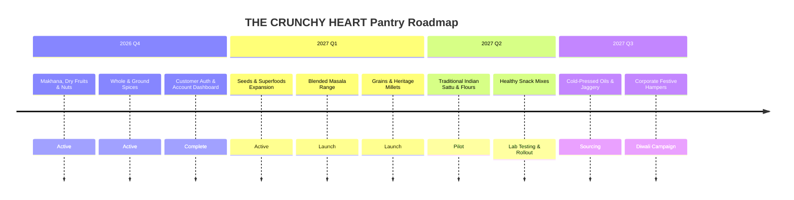

# THE CRUNCHY HEART — Complete Product Catalogue Expansion
## Document 18: Future Product Expansion & Pantry Roadmap

**Date**: November 18, 2026  
**Status**: Quarantined from Active Launch (Strategic Planning Only)

---

### 1. Categories Excluded from Initial Launch

To maintain strict operational focus on Makhana, Dry Fruits, Seeds, Spices, and Millets, the following three categories are catalogued for future roadmap releases and **must not be enabled on the active storefront without explicit approval**:

#### A. Future Category: Pulses & Legumes
- Whole Green Moong, Yellow Moong Dal, Black Chana, Kabuli Chana, Desi Chana
- Kashmiri Rajma, Chitra Rajma, Lobia (Black-eyed Peas)
- Whole Masoor (Brown Lentils), Red Masoor Dal (Split Red Lentils)
- Kulthi (Horse Gram), Urad Dal (Split & Whole), Desi Toor Dal, Dried Green Peas
- *Prerequisites*: Moisture testing, vacuum nitrogen packaging, sorting facility validation.

#### B. Future Category: Traditional Flours & Sattu
- Bihar Heritage Chana Sattu (Roasted Gram Flour)
- Gluten-Free Flours: Ragi Flour, Jowar Flour, Bajra Flour, Rajgira Flour (Amaranth), Kuttu Flour (Buckwheat)
- Cold Stone-Milled Whole Wheat Flour & Multi-Millet Blend
- *Prerequisites*: Stone-milling supplier contract, shelf-life and insect infestation testing (90-day limit).

#### C. Future Category: Pantry Oils & Heritage Sweeteners
- Natural Jaggery Blocks & Granular Jaggery Powder (Gur Shakkar)
- Dhaga Mishri (Thread Rock Sugar)
- Raw Forest Honey (Unpasteurized, Multi-floral)
- Cold-Pressed Kachi Ghani Mustard Oil, Groundnut Oil, White Sesame Oil, Virgin Coconut Oil
- Herbal Teas: Darjeeling Green Tea, Rama/Shyama Tulsi Tea, Dried Lemongrass Herbal Infusion
- *Prerequisites*: Glass bottling packaging design, AGMARK certification, cold-press extraction partner verification.

---

### 2. Multi-Year Phased Rollout Schedule

